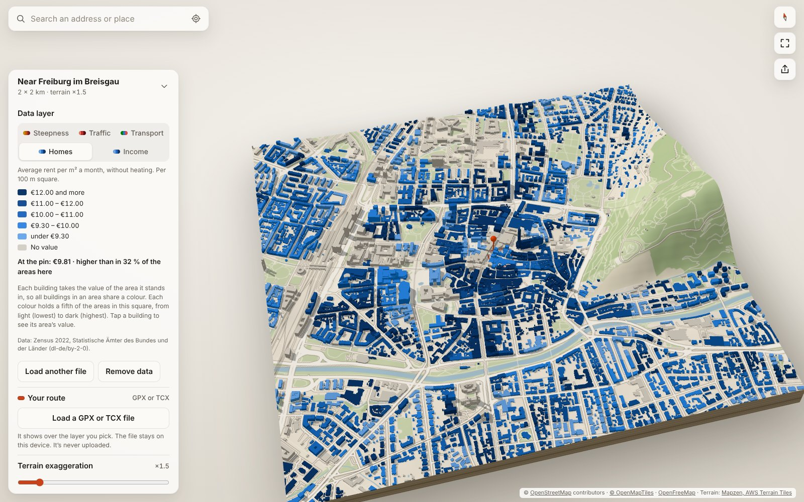

# Your Place

**Type any address and get the area around it as a 3D architect’s model: the real terrain underneath,
every building standing on top. Save a poster or a watertight STL to 3D print it. Free, no account,
works on your phone.**

**[Open Your Place →](https://yourplace3d.github.io/3d-city/)** · [How it works](https://yourplace3d.github.io/3d-city/about/) · [Changelog](CHANGELOG.md)

<p>
  
  
</p>

## What you can do

- **Search anything:** an address, a street, a village, a postcode or `lat, lon`, or use your location.
  Postcode and county results land on their village, not in a field.
- **See it in 3D:** any square from 300 m to 4 km around it, in 100 m steps, with terrain you can exaggerate (1×–5×) and contour lines.
  Buildings stand at their mapped height; where none is mapped the app estimates it and says how many.
  Show them in white, grey, sand or dark, or coloured by height (yellow through magenta to indigo, never
  green or light blue, so they don't look like parks or water).
- **Find a house:** slide the plate, tap a building to pin it, and “Centre here” to rebuild the square around it,
  or double-tap / double-click a spot to load the area there in one go.
- **In your language:** English, Spanish, Portuguese (Brazil) or German, from the browser's language or the picker in
  the settings. Share links carry no language, so each visitor sees their own.
- **Share it:** the link opens the same view with the same house pinned. It holds coordinates only, never the address you typed.
- **Fly over it:** a 12-second upright video (MP4) flying low along a diagonal of the square, with your
  title at the end. It's made on your device, frame by frame, and never uploaded.
- **Keep it:** download a poster image with the place name and coordinates (both can be replaced), or an STL file to 3D print
  (10, 15 or 20 cm wide; 2 km on 15 cm is 1:13,300), in one piece or in up to 8 × 8 tiles that fit your
  print bed. For painting, water sits 1 mm below the land, and roads (0.4 mm) and parks and woods (0.6 mm)
  can stand above it. Every exported shell is checked to be watertight.

## Controls

| | Touch | Mouse | Keyboard (model focused) |
| --- | --- | --- | --- |
| Turn and tilt | one finger | drag | arrow keys |
| Slide | two fingers | right-drag or Shift-drag | Shift + arrow keys |
| Zoom | pinch | wheel | + / − |
| Move the pin | tap a building or the ground | click | — |
| Load the area there | double-tap | double-click | — |
| North up / reset | compass / reset buttons | | N / 0 |

## Run it yourself

```bash
npm install
npm run dev        # http://localhost:5173
npm run build      # static site in dist/ — host it anywhere (relative paths)
npm test           # unit tests (vitest)
npm run e2e        # build + headless-browser test (needs Playwright), screenshots in e2e/out/
```

It is a static TypeScript app on three.js with no server and no API keys: the browser fetches map
tiles, terrain and address search straight from free public services.

**Deploys.** `.github/workflows/pages.yml` runs the unit tests, builds, and publishes `dist/` to
GitHub Pages on every push to `main`. One-time setup: **Settings → Pages → Build and deployment →
Source: GitHub Actions**. To publish a release, add its section to [CHANGELOG.md](CHANGELOG.md),
then run the **Release** workflow from the Actions tab with the version number (or push a tag such
as `v1.0.1`). It creates the tag and a GitHub release with that version’s notes.

**Own domain.** Point a DNS `CNAME` record (e.g. `3d.example.com`) at `yourplace3d.github.io`, enter the
domain under **Settings → Pages → Custom domain**, and change `SITE_URL` in `vite.config.ts` (or set
the `SITE_URL` environment variable in the build) so canonical links, preview images and the sitemap
use it.

## How it works

```
search ─▶ geocode (Photon / Nominatim)
            │
            ▼
   ┌── terrain tiles (Terrarium PNG, AWS) ──▶ N×N height grid ──▶ terrain mesh + plinth     ─┐
   ├── vector tiles (OpenFreeMap): buildings with heights ──▶ one merged extruded mesh      ├─▶ three.js scene
   └── vector tiles: roads/water/green/sea ──▶ canvas texture draped on the terrain         ─┘
                                           └▶ sea polygons → flatten to 0 m
       (Overpass API only when the tiles fail: raw OSM, height rule, coastline flood fill)
```

- `src/geo/` — data: projection, polygon utilities, terrain tiles, Overpass queries and parsing,
  the height rule, coastline sea fill, geocoding, an IndexedDB cache for Overpass responses.
- `src/scene/` — rendering: terrain + plinth, merged building mesh, the draped map-layer texture,
  shader patches (contour lines, contact darkening), the viewer (camera, lights, controls, export).
- `src/ui/` — search combobox, loading status, poster composition, the flyover video (encoded in the
  browser with WebCodecs and [Mediabunny](https://mediabunny.dev), MPL-2.0). `src/main.ts` wires it together.

Design notes:

- **Exaggeration applies to terrain only.** Each building vertex keeps its ground elevation and its
  height above ground, so moving the slider re-evaluates `y = (ground − ref) × ex + height` without
  rebuilding geometry; contour lines are computed per fragment from the real elevation.
- **Map layers are a texture, not geometry.** Rasterising roads/water/green into one canvas keeps
  them glued to the terrain at any exaggeration and costs no triangles; toggling a layer is a redraw.
- **The sea comes from coastlines, not elevation.** Terrain tiles report harbour water as ~0 m while
  polders sit below sea level, so elevation can't tell them apart. OSM coastlines (land on the left)
  are rasterised and the sea side flood-filled, then checked against the terrain before use.
- **Rural searches land on the village, not in a field.** Geocoders place a postcode or
  administrative area at the middle of its area — for rural postcodes that is open country between
  villages. Such results are resolved to the settlement the geocoder names for them, and a square
  with fewer than 10 buildings offers the nearest village or town outside it ("Kleinfelde is 2.0 km
  north-east — Go to Kleinfelde").
- **The print is a union of closed shells.** The STL holds a terrain block (height grid on top,
  side walls, flat base) and one closed prism per building that starts inside the block. Slicers
  union overlapping shells, so a building on a slope is exactly "the part above ground" without any
  boolean geometry in the browser. Scale is the print width over the square (15 cm for 2 km is
  1:13,300); buildings keep their real height at that scale, the terrain uses the on-screen
  exaggeration, and the base is 3 mm under the lowest point.
- **Every shell is closed, and no two shells touch.** Map data is messy, so each footprint is
  cleaned (repeated points, points on straight walls, hairline spikes), checked (simple rings,
  courtyards clear of the outer wall, a roof triangulation whose boundary is exactly the walls'
  top edges) and repaired with a polygon union when needed. Buildings cut by tile edges are joined
  again, and every building is inset by about 0.01 mm so terraced houses and stacked building
  parts never share a point (slicers close gaps that small). An outline that cannot be repaired is
  left out, and the dialog says so. Checked with trimesh on live data for Stuttgart 2 and 4 km,
  Barcelona's Eixample, Berlin courtyards, Hong Kong and a village: 38,692 shells, all watertight
  and outward-facing; one Barcelona building was left out.
- **Raised roads are their own pieces, not carved into the terrain.** The height grid's points are
  4–10 m apart, coarser than most roads, so a road in the grid would be a soft groove. Instead each
  road is cut into short pieces wherever the ground under it bends; each piece is a closed shell whose
  top follows the printed terrain (the same two triangles per grid cell) 0.4 mm up and whose floor is
  buried in the block. Corners up to 90° are mitred, sharper ones get an octagon, and pieces overlap
  slightly instead of sharing faces. Roads thinner than 0.3 mm at true scale are left out, the rest
  are at least 0.5 mm wide, and bridges keep a level deck between their ends.
- **Renders on demand.** Frames are drawn only while the camera moves or something changes.

## Technical choices

- **Renderer:** three.js, not MapLibre — the physical-model look (plinth walls, contact shadow,
  poster renders, STL export) needs full control of the geometry.
- **No server:** the browser fetches public services directly, behind small interfaces
  (`loadHeightGrid`, the tile loader, `overpass`, `suggest`) that an own tile server or geocoder could
  replace if traffic outgrows the free services.
- **Elevation:** Mapzen/AWS Terrarium tiles (worldwide, CORS, no key; ~10–30 m sources incl.
  SRTM, EU-DEM, 3DEP) instead of Copernicus GLO-30 GeoTIFFs, which need server-side processing.
- **Search engines:** the app page and a static “How it works” page (`about/`) carry titles,
  descriptions, canonical links, Open Graph images and structured data; the build writes
  `sitemap.xml` and `robots.txt` from `SITE_URL`.

## Data and licences

- Map data © OpenStreetMap contributors, ODbL. Attribution is shown in the app, on posters, in
  flyover videos and in the STL file header; please keep “© OpenStreetMap contributors” next to anything you share.
- Vector tiles: [OpenFreeMap](https://openfreemap.org), schema © [OpenMapTiles](https://openmaptiles.org).
  Fallback map data: the [Overpass API](https://overpass-api.de).
- Terrain: Mapzen terrain tiles on AWS Open Data — see the
  [attribution list](https://github.com/tilezen/joerd/blob/master/docs/attribution.md).
- Address search: [Photon](https://photon.komoot.io) by komoot (suggestions, place names for shared
  links) and [Nominatim](https://nominatim.org) (only when you press Enter before suggestions arrive,
  per its usage policy).
- Photon, Nominatim and Overpass are shared community services with fair-use limits. If the app gets
  very popular, the address search should move to an own or paid geocoder.

## Privacy

No account, no cookies, no analytics, no server of its own. What you type in the search box goes from
your browser to Photon or Nominatim; share links hold only coordinates and the view; map data you
loaded is cached on your device.

## Known limitations

- No LiDAR surface model yet, so many heights are estimates (the app says how many).
- Building parts follow Simple 3D Buildings only partly: roofs are flat, outlines hosting
  `building:part`s are dropped.
- Terrain sea-floor values are clamped at −30 m until coastlines arrive; places far below sea level
  (Dead Sea, Death Valley) are flattened by that clamp.
- No level of detail yet; the 4 km area at full density can be heavy on older phones.

## Ideas for later

- **Colour the blocks.** The OpenMapTiles building layer has a `colour` field (from OSM
  `building:colour` / `building:material`) where mappers recorded one, so a "real colours" style is
  cheap. Letting people paint their own house builds on the pin, which already marks one building.
- **Photos on the buildings.** Aerial imagery on roofs and ground is the realistic first step —
  the hard part is an imagery licence that allows it. Street-level photos on façades are a much
  bigger job (coverage, licensing, matching photos to walls).
- **Multi-colour 3MF** (terrain, buildings, roads and water as separate parts for AMS-style printers),
  a name engraved in the base, and **poster styles** (title layouts, colours).

## Testing

`npm test` covers projection, terrain decoding/resampling, polygon clipping and ring assembly,
OSM parsing (multipolygons, courtyards, building parts, clipping), the height rule, the sea fill,
building-mesh winding and exaggeration, URL state, and the STL export (every shell closed and
outward-facing, volumes, binary format).

`npm run e2e` serves the build, answers Overpass and geocoding from a deterministic synthetic city
(`e2e/fixtures/synthetic-city.mjs`), uses real terrain tiles, and drives search, every control,
keyboard camera, pinning a building (click, drag, share-link round-trip, "Centre here"),
Shift-arrow and two-finger sliding, share link round-trip, poster download, STL download (size and
base checked), an Overpass outage with retry, a phone
viewport, and dark mode with reduced motion. It fails on any console error.

## Licence

The code is released under the [MIT Licence](LICENSE). Map data and terrain shown by the app keep
their own licences (see “Data and licences” above).
